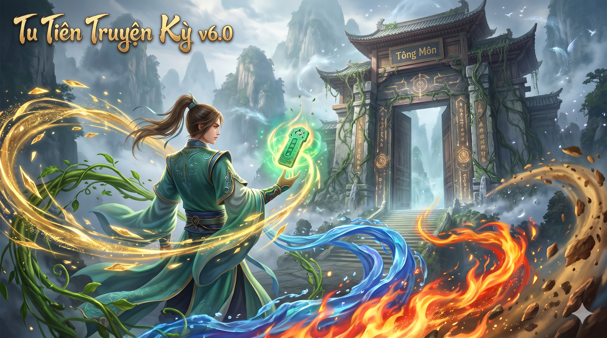

# 🐉 KHAI MỞ MÁY CHỦ: TU TIÊN TRUYỀN KỲ V6.0 🐉
> *"Một bước vào tiên môn, vạn kiếp bất phục phàm trần. Liệu đạo hữu sẽ hóa thành tro bụi dưới Thiên Lôi, hay ngự kiếm phi thăng độc bộ thiên hạ?"*

✨ **ĐIỂM ĐẶC SẮC PHIÊN BẢN V6.0:**
• 🎨 Giao diện **Thủy Mặc & Ngọc Bích** mượt mà, hỗ trợ chơi trực tiếp trên mọi trình duyệt (PC & Mobile).
• 🧘 **Tu Luyện Idle:** Tự động tụ khí tăng tu vi từ **Phàm Nhân** đến **Chân Tiên**.
• ⚔️ **Tứ Đại Xuất Thân:** Kiếm Tu (Bạo kích) - Đan Sư (Luyện dược) - Thể Tu (Bất diệt) - Tán Tu (Cơ duyên).
• ⚡ **Bát Đại Hệ Thống:** Linh Căn, Tông Môn, Công Pháp, Luyện Đan, Luyện Khí, Độ Kiếp Lôi Đình, Bí Cảnh & Trảm Yêu Trừ Ma.

━━━━━━━━━━━━━━━━━━━━━━━━━━━━━━━━━━
🧭 **HƯỚNG DẪN TÂN THỦ NHẬP MÔN (3 BƯỚC):**
1️⃣ **Bước 1 - Lấy Lệnh Bài (Key):** Truy cập Link lấy Key bên dưới để nhận mã kích hoạt định dạng `CTTV-XXXX-YYYY-ZZZZ`.
2️⃣ **Bước 2 - Khởi Tạo Nhân Vật:** Vào link game, nhập Key kích hoạt, đặt Đạo Hiệu và chọn Xuất Thân + Tông Môn.
3️⃣ **Bước 3 - Tu Luyện & Độ Kiếp:** Học công pháp sơ cấp -> Đi Bí Cảnh săn nguyên liệu -> Luyện đan tăng tỷ lệ -> Độ Kiếp đột phá cảnh giới!

━━━━━━━━━━━━━━━━━━━━━━━━━━━━━━━━━━

🔗 **LINK TRUY CẬP CHÍNH THỨC:**

   **Link Vào Game:** [⚔️ Nhấn vào đây để vào Game](https://kaimc098.github.io/tu-tien-truyen-ky-v7.2/)

   **Link Lấy Key Kích Hoạt:** [👉 Nhấn vào đây để lấy Key](https://kaimc098.github.io/Get-key/)

   **Máy chủ discord:**[👉 Nhấn vào đây để lấy Key](https://discord.gg/mh99RqutJf)

💬 *Chúc chư vị đạo hữu tiên vận hanh thông, sớm ngày đắc đạo phi thăng!*
